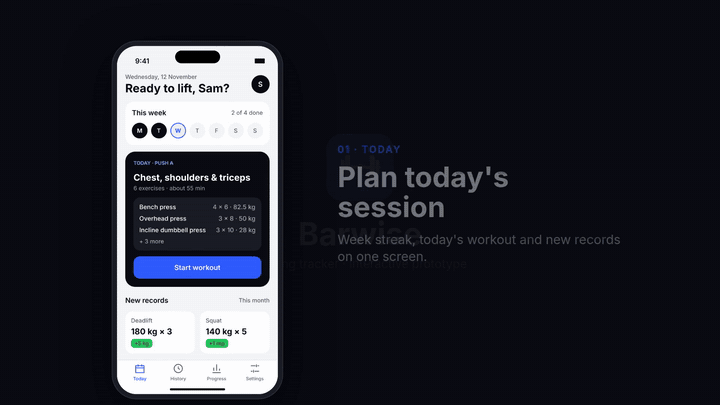
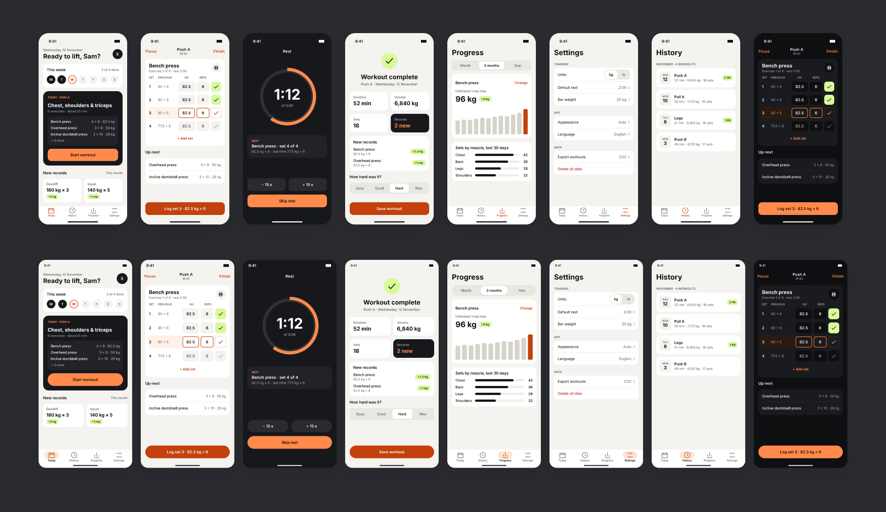
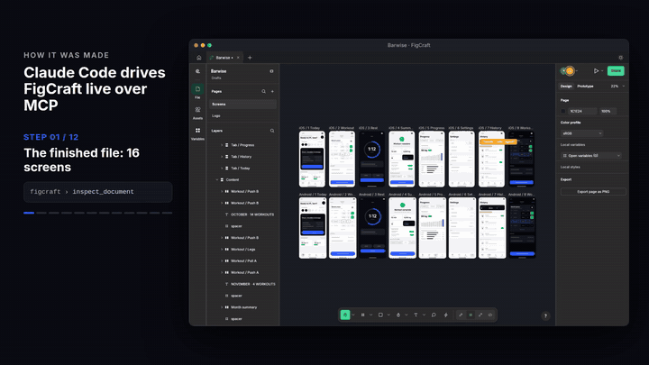
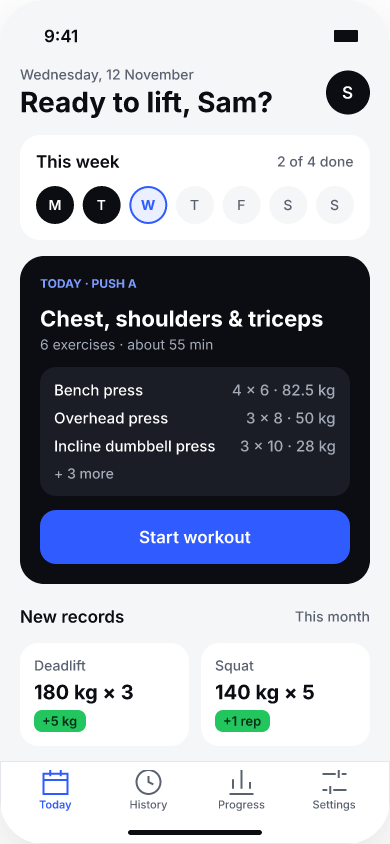
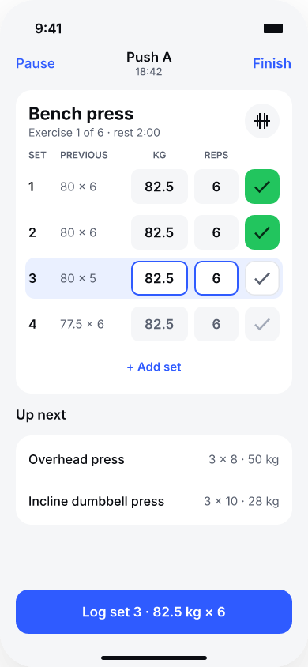
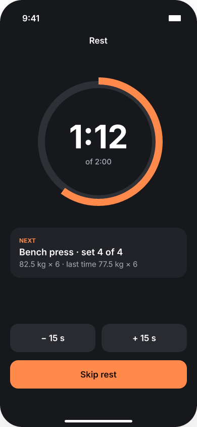
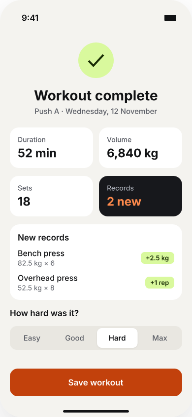

<div align="center">

# mobile-app-designer

**A [Claude Code](https://claude.com/claude-code) skill that designs a mobile app end to end,
checks it like a senior designer, and hands it off ready to build.**

[](https://github.com/chrollo-03/mobile-app-designer/actions/workflows/check.yml)
[](https://github.com/chrollo-03/mobile-app-designer/releases)
[](LICENSE)




**[Watch the full film (1:02, MP4)](examples/barwise/video/barwise-film.mp4)**: how it was made, then the app in use.

</div>

## Made with this skill: Barwise

Barwise is a lifting tracker designed from a one-line idea by Claude Code with this skill,
working live in [FigCraft](https://github.com/storytold/figcraft) over MCP. Everything in
[`examples/barwise`](examples/barwise) is real output: the design file, the screens, the
prototype, the icon and the checks.

| 16 screens | 2 platforms | 1 prototype | 137 / 137 | 0 |
|:---:|:---:|:---:|:---:|:---:|
| 8 per platform, plus dark mode | iOS 390 x 844, Android 412 x 917 | every button and tab linked | design checks passed | contrast or tap-target issues |



### How it was made

Each frame below is a real capture of the FigCraft window while Claude Code rebuilt the Rest
timer screen, one MCP command per step, including the bug it hit (the progress arc drew a pie
slice) and the fix.



[Making-of (29 s, MP4)](examples/barwise/video/barwise-making-of.mp4) ·
[Walkthrough (33 s, MP4)](examples/barwise/video/barwise-walkthrough.mp4) ·
[Case study](examples/barwise/README.md) ·
[Video source (Remotion)](examples/barwise/video)

<table>
<tr>
<td></td>
<td></td>
<td></td>
<td></td>
</tr>
<tr>
<td align="center">Plan today</td>
<td align="center">Log every set</td>
<td align="center">Rest timer</td>
<td align="center">New records</td>
</tr>
</table>

## How it works

The skill walks Claude through eight phases, asks only the decisions that are yours to make,
and verifies every visual step with screenshots and scripts.

| # | Phase | What you get |
|:-:|---|---|
| 1 | Brief and data | `BRIEF.md` with platforms, languages, online or offline, personal data, real data profiled |
| 2 | Tool setup | FigCraft detected, or downloaded with SHA-256 verification and connected (headless or live) |
| 3 | Design system | colour roles for light and dark that pass WCAG AA, type scale, spacing, components |
| 4 | Screens | iOS and Android screens that follow each platform's conventions |
| 5 | Prototype | a clickable prototype with working inputs: variables, sheets, toggles, typing |
| 6 | Logo and icon | app icon and mark from the product's own visual language, checked at real sizes |
| 7 | Checks | every screen on every platform, links, flows, reachability, contrast, tap targets |
| 8 | Handoff | a zip with a build prompt, setup guide, tokens and PNGs another developer or Claude can build from |

Arabic and right-to-left support runs through every phase.

## What's inside

- **The workflow** (`SKILL.md`), designed by **app type** with 12 guides: finance, health and
  fitness, wellness, food and delivery, e-commerce, social, productivity, travel, education,
  media, booking, utility.
- **Design rules with reasons** (`references/design-principles.md`): 8-pt grid, type scale,
  WCAG contrast, 44/48 tap targets, one primary action, Fitts's and Hick's laws, states, motion,
  platform fit and a review checklist.
- **A colour system**: `scripts/palette.py` turns one brand colour into full light and dark
  roles, checks contrast and exports CSS, Jetpack Compose, SwiftUI, Flutter or design tokens;
  13 curated palettes; and **`assets/color-panel.html`**, a visual picker with phone previews.
- **Six scripts** (Python 3, no dependencies):

| Script | Does |
|---|---|
| `check_design.py` | screens on every platform at the right size, links, key flows, reachability, variables at defaults, exports |
| `audit_design.py` | WCAG contrast of every text layer and tap-target sizes, including inside components |
| `palette.py` | colour system from a seed, contrast report, exports, preset check, builds the colour panel |
| `extract_tokens.py` | the text styles, colours, gradients and radii a design really uses |
| `figcraft_setup.py` | detects OS and design-tool setup, downloads FigCraft with SHA-256 verification |
| `escape_invisible.py` | finds and escapes invisible and bidi control characters in code |

- **Templates**: project brief, build prompt, setup guide, design tokens, handoff README, checker spec.

## Install

A Claude Code skill is a folder with a `SKILL.md`. Clone it into your skills folder:

```bash
git clone https://github.com/chrollo-03/mobile-app-designer ~/.claude/skills/mobile-app-designer
```

(or into `.claude/skills/` inside one project). Restart Claude Code; the skill triggers when you
ask to design, prototype, check or package a mobile app, or when you call it by name.

## Try it

> Design a lifting tracker for iOS and Android with dark mode, make the prototype clickable, and
> give me a zip my developer can build from.

> Open the colour panel and help me pick colours for my meditation app.

> Check my design file design/App.figcraft: every screen on both platforms, contrast and tap targets.

Or run the checks on the bundled example:

```bash
cd ~/.claude/skills/mobile-app-designer
python3 scripts/check_design.py examples/barwise/design-spec.json          # 137 passed, 0 failed
python3 scripts/audit_design.py examples/barwise/Barwise.figcraft Screens   # 0 issues
python3 scripts/palette.py list && python3 scripts/palette.py preset health-fitness
xdg-open assets/color-panel.html     # macOS: open, Windows: start
```

## Layout

```
SKILL.md            the workflow
references/         loaded per phase: app types, inspiration, design principles, colour,
                    install FigCraft, FigCraft recipes, other tools, design system, prototype,
                    RTL/Arabic, logo, checks, handoff
scripts/            the six scripts above
assets/             palettes.json, color-panel.html (+ its template)
templates/          brief, build prompt, setup, tokens, handoff README, checker spec
examples/barwise/   a complete design: FigCraft file, screens, icon, checker spec, videos
evals/              test cases for `claude plugin eval`
```

## Test cases

`evals/` holds four realistic prompts in the format `claude plugin eval` reads. Running them makes
real (billed) model runs with and without the skill:

```bash
claude plugin eval . --allow-tools Write,Edit,Bash --scaffold
```

## License

MIT, see `LICENSE`. Made by [Chrollo](https://github.com/chrollo-03).
