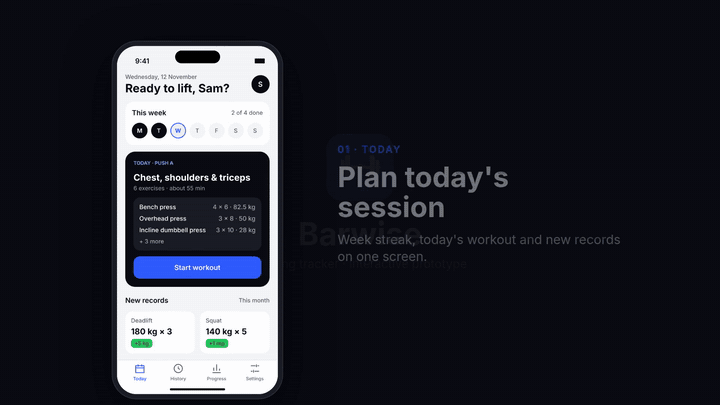

# Example: Barwise, a lifting tracker (iOS + Android)

A complete design made with this skill in FigCraft: 16 screens (8 per platform), a clickable
prototype, an app icon and a checker spec. All names and numbers are made up.


**Prototype walkthrough** ([MP4, 33 s](video/barwise-walkthrough.mp4)):



## Brief
Log strength workouts fast, between sets, with one hand. Plan today's session, log weight and
reps per set, rest with a timer, see new records at the end, and track strength over months.
Offline first, no account needed.

## What's in the file
- **Page `Screens`**: `iOS / N Name` (390 x 844) and `Android / N Name` (412 x 917):
  1 Today, 2 Workout, 3 Rest, 4 Summary, 5 Progress, 6 Settings, 7 History, 8 Workout · dark.
- **Page `Logo`**: the 1024 px app icon and the `Logo / mark` frame (white barbell with a
  green "progress" dot on electric blue).
- **Prototype**: Start workout → Workout → Log set → Rest → Skip rest → Workout → Finish →
  Summary → Save workout → Today, plus every tab, on both platforms.

| | |
|---|---|
|  |  |
|  |  |

## Decisions that shaped it
- **One primary action per screen**: Start workout, Log set, Skip rest, Save workout. The rest
  are text buttons or quiet secondary buttons.
- **The current set is the loudest thing on the Workout screen**: tinted row, outlined inputs,
  and the bottom button repeats exactly what will be logged ("Log set 3 · 82.5 kg × 6").
- **"Previous" column**: last session's numbers sit next to today's inputs, so progressive
  overload needs no memory.
- **Records get their own colour**: green is used only for done sets and new records, so it
  always means "good news". Every action is the same electric blue.
- **Rest is dark on purpose**: the screen people stare at between sets is calm and readable
  from a distance.
- **Platform fit**: iOS tab bar with home indicator and 44 pt targets; Android navigation bar
  with a pill on the active tab, gesture handle, pill buttons and 48 dp targets.

## Colour tokens
| Role | Light | Dark |
|---|---|---|
| Background | `#F5F6F8` | `#07080B` |
| Surface | `#FFFFFF` | `#151821` |
| Text | `#0B0D12` | `#F2F2F3` |
| Text, secondary | `#5A6170` | `#A3AAB8` |
| Action (buttons, active tab) | `#2F5BFF` | `#2F5BFF` |
| Action text on dark | | `#7C9BFF` |
| Hero / rest | `#0B0D12` | `#0B0D12` |
| Done / record | `#22C55E` with `#052E16` text | same |

One accent colour for every action, green only for good news, cool greys for everything else.

Font: Inter on both platforms.

## Check it yourself
```bash
python3 skills/mobile-app-designer/scripts/check_design.py examples/barwise/design-spec.json      # 137 passed, 0 failed
python3 skills/mobile-app-designer/scripts/audit_design.py examples/barwise/Barwise.figcraft Screens   # 0 issues
python3 skills/mobile-app-designer/scripts/extract_tokens.py examples/barwise/Barwise.figcraft Screens "iOS /"
```
